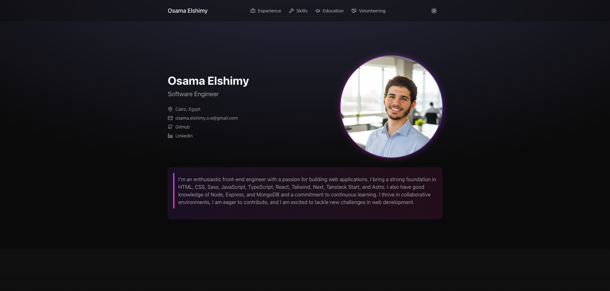

# My Portfolio

A responsive portfolio for Osama Elshimy, built with **Astro**, **React**, and **Tailwind CSS**.



## ✨ Features

- Responsive layout with a translucent navigation bar and Lucide icons
- Entrance animations and hover effects powered by Framer Motion
- Light and dark themes that default to the system preference, with a toggle that remembers your choice
- Sections for work experience, skills, education, and volunteering

## 🚀 Demo

👉 [Live Demo](https://osamaelshimy.vercel.app/)

## 🛠 Getting Started

### Prerequisites

- Node.js (v20+ recommended)
- npm / yarn / bun / pnpm

### Installation

```bash
git clone https://github.com/Osama-Elshimy/Portfolio.git
cd Portfolio

# Install dependencies
npm install
# or
yarn install
# or
pnpm install
# or
bun install

# Start development server
npm run dev
# or
yarn dev
# or
pnpm dev
# or
bun dev
```

Visit `http://localhost:4321` in your browser to see it in action.

## 🧩 Customizing the Portfolio

Edit the homepage content in [`src/lib/data.ts`](./src/lib/data.ts).

### 1. Personal Info

```ts
export const personalInfo = {
  name: "Your Name",
  location: "Your Location",
  email: "your.email@example.com",
  github: "https://github.com/yourusername",
  linkedin: "https://www.linkedin.com/in/yourusername/",
  profilePicture: "/personal-pic.jpg",
  heroDescription: "A short introduction about your work and interests.",
};
```

Replace `public/personal-pic.jpg` to use your own portrait.

### 2. Work Experience

```ts
export const workExperience = [
  {
    company: "Company Name",
    location: "Location",
    position: "Your Position",
    period: "Start Date - End Date",
    achievements: ["Achievement 1", "Achievement 2"],
  },
];
```

### 3. Skills

```ts
export const skills = {
  programmingLanguages: ["TypeScript", "Python"],
  frontendDevelopment: ["React", "Next.js"],
  toolsAndServices: ["Git", "Bash"],
};
```

### 4. Education

```ts
export const education = [
  {
    institution: "University Name",
    location: "Location",
    degree: "Your Degree",
    period: "Start Date - End Date",
  },
];
```

### 5. Volunteering Experience

```ts
export const volunteering = [
  {
    role: "Volunteering Role",
    organization: "Volunteering Organization",
    location: "Volunteering Location",
    period: "Start Date - End Date",
  },
];
```

## 📦 Build for Production

```bash
npm run build
# or
yarn build
# or
pnpm build
# or
bun run build
```

To preview the production build locally:

```bash
npm run preview
# or
yarn preview
# or
pnpm preview
# or
bun preview
```

## 📤 Deployment

The portfolio is hosted on **Vercel**. The Astro production build writes the static site to `dist/`.

---

## 🙏 Acknowledgments

- [Astro](https://astro.build/)
- [React](https://reactjs.org/)
- [Tailwind CSS](https://tailwindcss.com/)
- [Framer Motion](https://www.framer.com/motion/)
- [Lucide Icons](https://lucide.dev/)
